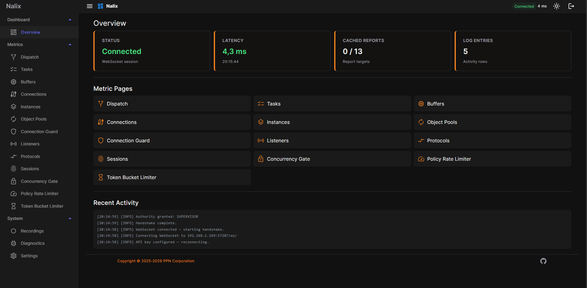
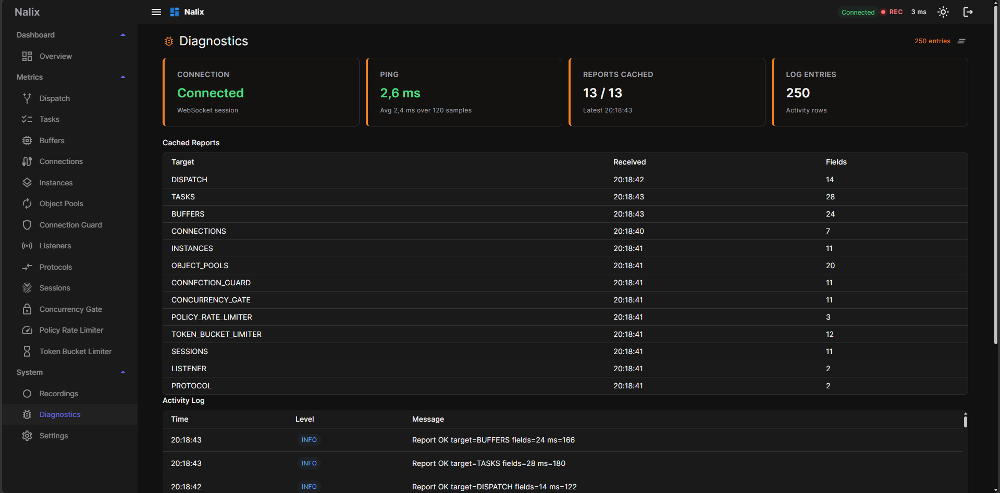
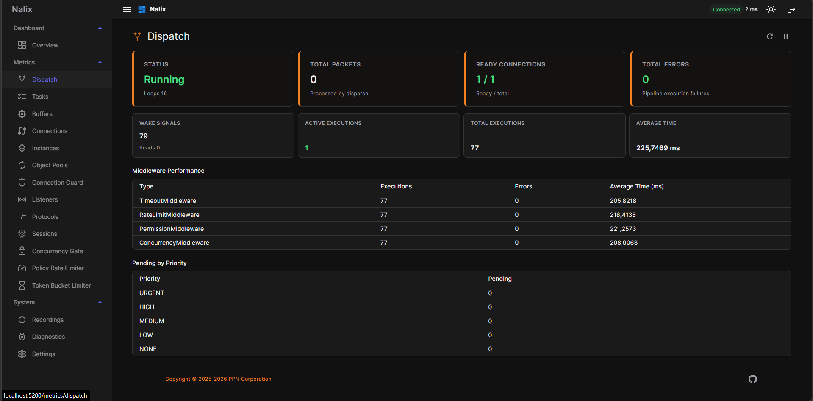
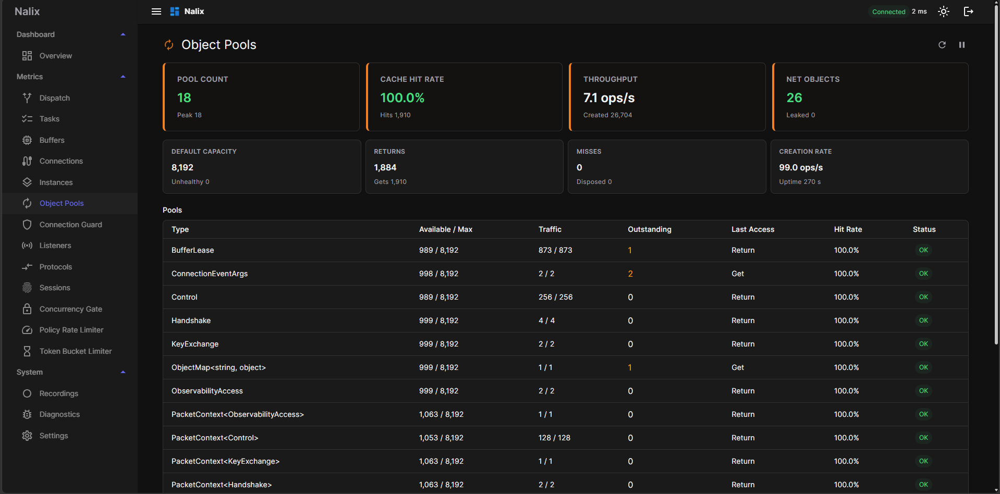
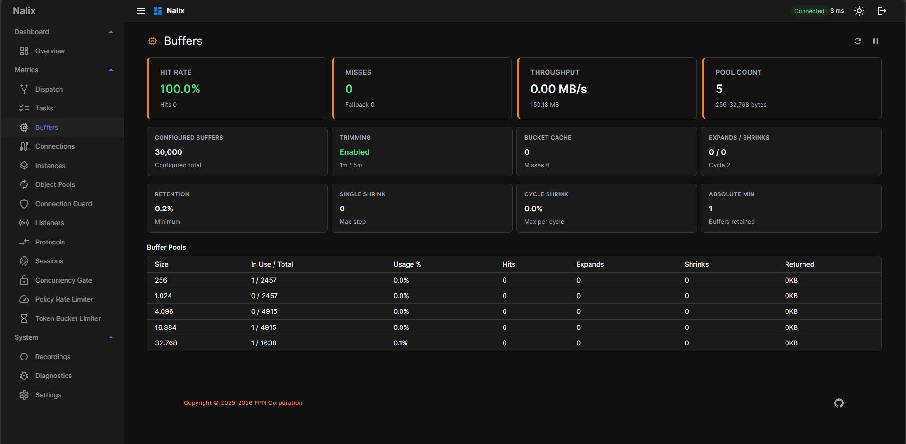
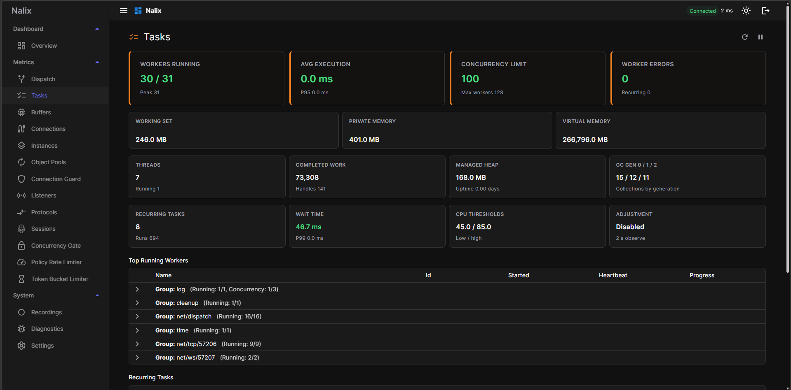
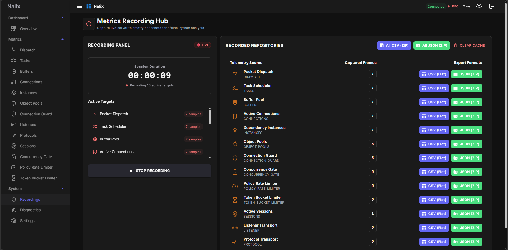

# 🖥️ Blazor Dashboard Visual User Guide

This guide describes how to navigate, interpret, and troubleshoot Nalix applications using the interactive **Blazor Observability Dashboard**.

---

## 🔑 Access and Connection

When you first launch the dashboard, you must authorize and connect to your active backend application:
1. Provide the **64-character Security Key** configured on your backend server.
2. Enter the WebSocket endpoint address (e.g., `ws://localhost:57207/ws/`).
3. Click **Connect** to begin streaming live statistics.

Once connected, you can navigate between the tabs on the left sidebar:

---

## 1. Overview Tab

The **Overview** dashboard provides an at-a-glance summary of your Nalix server's general health, connectivity, and hardware footprint.



### Key Metrics:
* **Active Connections:** The number of client sessions currently connected to the WebSocket.
* **System Resource Usage:** Current CPU utilization percentage and physical memory (RAM Working Set in MB).
* **Throughput Metrics:** Raw rates of packets processed per second.

### Diagnostic Actions:
* **Quick Health Assessment:** Ensure resource usage stays within safe baselines during peak times.
* **Connection Drops:** Watch for sudden drops in Active Connections which may indicate network or keep-alive failures.

---

## 2. Diagnostics Tab

The **Diagnostics** view features real-time historical graphs tracking resource metrics over time.



### Key Metrics:
* **Working Set MB vs. Managed Heap MB:** Correlates OS physical RAM allocation (Working Set) with .NET Garbage Collection Heap (Managed Heap). A diverging gap indicates native memory leaks (e.g. unmanaged buffers).
* **Threads & Running Threads:** Monitors thread pool health. A rising trend indicates thread starvation or blocked worker threads.
* **Connection Count Trend:** Tracks load spikes over time.

---

## 3. Dispatch Tab

The **Dispatch** dashboard focuses on Nalix's underlying message-handling pipeline, queue depths, and execution latencies.



### Key Metrics:
* **Pending by Connection:** Lists active connections and the number of messages queued up in each connection's pending mailbox.
* **Dispatch Cycles:** Tracks how quickly the message loop pumps messages out of queues.
* **Hotspots Identification:** Highlights connection queues with abnormally high pending counts, helping you isolate slow or malicious client connections causing blockages.

---

## 4. Objects Tab

The **Objects** dashboard details active object pools to help optimize memory allocation patterns and minimize Garbage Collector (GC) pressure.



### Key Metrics:
* **Pool Capacity vs. Rented Instances:** Displays the usage ratio of pre-allocated buffers and object pools.
* **Active Type Pools:** Lists all pooled object classes (e.g. `PacketContext`, `BufferSegment`).
* **GC Pressure Warning:** High lease-and-return frequency with low hit-rates signifies object allocation thrashing, leading to CPU spikes during GC collection cycles.

---

## 5. Buffers Tab

The **Buffers** view focuses on raw byte buffers and segment allocations, critical for high-throughput network streaming applications.



### Key Metrics:
* **Segment Utilization:** Displays active rented byte arrays.
* **Buffer Fragmentation:** Monitors how memory is segmented across blocks.
* **Leak Watch:** Renting buffers without properly returning them to the pool causes rapid memory inflation, which is visible here as a continuous upward slope.

---

## 6. Tasks Tab

The **Tasks** dashboard monitors internal asynchronous tasks running on the Nalix Scheduler.



### Key Metrics:
* **Active Tasks:** Count of active async tasks/promises.
* **Task Queues:** Visualizes the backlog of tasks waiting to run.
* **Blocked Schedulers:** If tasks stay in the queue indefinitely, it indicates deadlocks or long-running synchronous code blocking the async thread pool.

---

## 7. Recordings Tab

The **Recordings** dashboard allows you to record live sessions and export telemetry data for offline post-mortem diagnostics.



### Diagnostic Workflows:
1. **Start Recording:** Trigger a recording capture during a load test or a suspected issue.
2. **Stop & Save:** Stop the capture.
3. **Export CSV:** Export individual files (`process_metrics.csv`, `dispatch_metrics.csv`, `object_pools_metrics.csv`, etc.).
4. **Offline Analysis:** Run the exported CSV folder through the **[Nalix Telemetry Analyzer](../analyzer/README.md)**:
   ```powershell
   .\analyzer\dist\Nalix.Analyzer.exe --dir path/to/exported_csvs --format all
   ```
